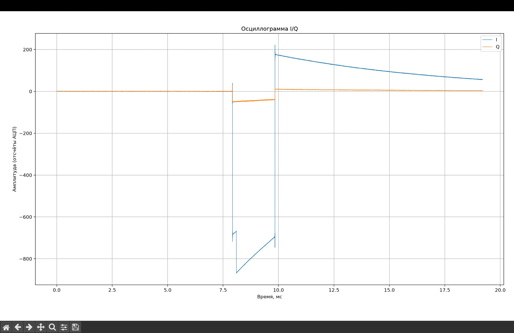

# Отчёт по лабораторной работе

**Тема:** Приём и передача I/Q-отсчётов с аппаратными временными метками на ADALM-Pluto SDR

## Цель работы

Изучить работу потоков RX и TX через SoapySDR, получить аппаратные временные метки принимаемых буферов и запланировать передачу относительно времени приёма. Сохранить принятые I/Q-отсчёты и построить осциллограмму.

## Оборудование и программное обеспечение

- ADALM-Pluto SDR.
- SoapySDR и драйвер SoapyPlutoSDR с поддержкой timestamp.
- C++17 и CMake.
- Python с NumPy и Matplotlib для визуализации отсчётов.

## Параметры эксперимента

| Параметр | Значение |
| --- | --- |
| Канал | `0` |
| URI устройства | `usb:` |
| Частота RX и TX | 800 МГц |
| Частота дискретизации | 1 МГц |
| Формат отсчётов | `CS16`: пары `int16_t` I/Q |
| Усиление RX | 10 |
| Усиление TX | −89 |
| Интервал timestamp | 1920 отсчётов |
| Число попыток чтения | 10 |
| Планируемая задержка передачи | 4 мс относительно timestamp RX-буфера |

## Ход работы

1. Создано устройство SoapySDR с параметрами `driver=plutosdr`, `direct=1`, `timestamp_every=1920` и `loopback=0`.
2. Настроены частота дискретизации, центральная частота и усиление RX/TX.
3. Созданы и активированы потоки приёма и передачи. Размеры буферов определены через `getStreamMTU`.
4. Сформирован TX-буфер. Его полезная часть содержит постоянные значения `I = Q = 1500 << 4`; первые 12 слов зарезервированы под маркеры и временную метку.
5. В цикле выполнено чтение RX-буферов. Для каждого успешно полученного буфера выведены число отсчётов, флаги, timestamp и разность временных меток.
6. На третьей итерации, при успешном чтении и наличии флага `SOAPY_SDR_HAS_TIME`, запланирована отправка одного TX-буфера через 4 мс после timestamp принятого буфера.
7. Принятые I/Q-отсчёты сохранены в `rxdata.pcm`. После завершения работы потоки и устройство освобождены.

Время передачи задаётся выражением:

```cpp
const long long tx_time_ns = time_ns + 4LL * 1000 * 1000;
```

Эта временная метка разбивается на восемь байтов и помещается между маркерами `FFFF FFFF` в начале TX-буфера. При вызове `writeStream` также передаются время отправки и флаг `SOAPY_SDR_HAS_TIME`.

## Результат



*Рисунок 1 — осциллограмма I- и Q-компонент принятого сигнала. По горизонтали отложено время в миллисекундах, по вертикали — амплитуда в отсчётах АЦП.*

На графике до примерно 8 мс компоненты находятся около нулевого уровня. В области 8–10 мс наблюдается выраженное изменение I- и Q-компонент, после которого сигнал постепенно приближается к исходному уровню. Форма записи отражает переходные процессы и особенности радиотракта при передаче буфера с постоянной полезной частью.

Заданные 4 мс — это интервал между timestamp принятого буфера и запланированным временем TX. Сама осциллограмма без сопоставления временных меток не является измерением задержки распространения сигнала.

## Вывод

Реализована работа RX- и TX-потоков ADALM-Pluto SDR через SoapySDR. Использованы аппаратные временные метки для планирования передачи относительно принятого буфера. Принятые I/Q-отсчёты сохранены в файл и представлены в виде осциллограммы, на которой виден участок изменения сигнала.
