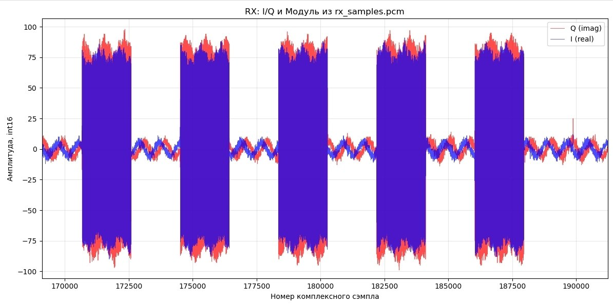
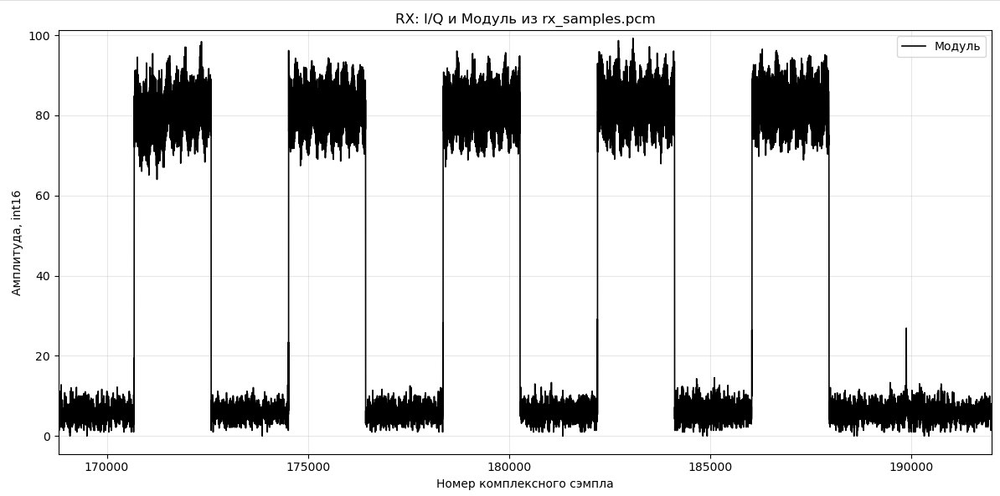

# Отчёт по лабораторной работе

**Тема:** Передача самостоятельно сформированных I/Q-отсчётов между двумя ADALM-Pluto SDR

## Цель работы

Реализовать передачу самостоятельно сформированного комплексного сигнала с одной SDR на другую, сохранить принятые I/Q-отсчёты и исследовать их форму и огибающую. Вынести настройки в структуру `config` и реализовать выбор режима работы и устройства через аргументы командной строки.

## Оборудование и программное обеспечение

- Два устройства ADALM-Pluto SDR: передатчик и приёмник.
- Программа на C++17 с использованием SoapySDR и драйвера SoapyPlutoSDR с поддержкой timestamp.
- CMake для сборки программы.
- Python, NumPy и Matplotlib для обработки и отображения записи.

## Организация программы

| Файл | Назначение |
| --- | --- |
| `config.hpp` | Структура `config` с параметрами устройства и потоков |
| `main.cpp` | Разбор аргументов командной строки и выбор режима `tx` или `rx` |
| `sdr_runner.cpp` | Настройка SDR, формирование сигнала, передача и приём |
| `../../../py_script/oscillogram.py` | Чтение сохранённых отсчётов и построение графиков |

Для обоих устройств используется один исполняемый файл `pluto_sdr`. Роль устройства определяется аргументом запуска.

### Структура config

Настройки собраны в структуре `config`, которая передаётся в функцию `run_sdr` по константной ссылке. Это позволяет использовать общий код для передатчика и приёмника.

| Параметр | Значение в текущем коде | Назначение |
| --- | --- | --- |
| `is_tx` | Задаётся режимом запуска | Выбор передачи или приёма |
| `channel` | `0` | Номер канала |
| `sample_rate` | `2e6` | Частота дискретизации, 2 МГц |
| `freq1` | `800e6` | Частота TX передающего узла и RX принимающего узла |
| `freq2` | `850e6` | Частота вспомогательного RX передающего узла и настройки TX принимающего узла |
| `rx_gain`, `tx_gain` | `45.0`, `45.0` | Заданные значения усиления RX и TX |
| `timeout_us` | `400000` | Тайм-аут потоковых операций, мкс |
| `direct` | `1` | Использование прямого USB-потока |
| `timestamp_every` | `1920` | Интервал аппаратных временных меток, в отсчётах |
| `loopback` | `0` | Внутренний loopback отключён |

Размер обрабатываемого буфера задаётся константой `SIZE_BUF = 1920`. В структуре также есть `iteration_count = 100`, но в текущей реализации цикл работает до остановки программы, а это поле не используется.

### Аргументы командной строки

Формат запуска:

```text
pluto_sdr <tx|rx> [URI устройства]
```

Первый аргумент выбирает режим работы, второй позволяет указать конкретное устройство. Если URI не задан, используется `usb:`. Для работы с двумя SDR необходимо указать разные URI. Остальные параметры задаются в `config.hpp`.

Сборка из корня репозитория:

```sh
cmake -S adalm_pluto/dev -B adalm_pluto/dev/build \
  -DSoapySDR_DIR="$HOME/.local/telecom-sdr/share/cmake/SoapySDR"
cmake --build adalm_pluto/dev/build --target pluto_sdr
```

Пример запуска из каталога `adalm_pluto/dev/build` в двух терминалах:

```sh
# Сначала запустить приёмник.
./pluto_sdr rx <URI_приёмника>
```

```sh
# Затем запустить передатчик на другом устройстве.
./pluto_sdr tx <URI_передатчика>
```

Обозначения `<URI_приёмника>` и `<URI_передатчика>` следует заменить реальными URI без угловых скобок. Завершение работы выполняется сочетанием `Ctrl+C`.

## Формирование и передача I/Q-отсчётов

Комплексный сигнал формируется программно:

```text
s[n] = I[n] + j·Q[n]
I[n] = A·cos(φ[n])
Q[n] = A·sin(φ[n])
φ[n+1] = φ[n] + 2π·fтон/Fs
```

В программе заданы амплитуда `A = 16000`, частота тона `fтон = 100 кГц` и частота дискретизации `Fs = 2 МГц`. В формате `CS16` каждый комплексный отсчёт представлен двумя числами `int16_t`: `I0, Q0, I1, Q1, ...`. Поэтому для 1920 комплексных отсчётов выделяется 3840 чисел `int16_t`.

Функция `fill_tx_buffer` чередует буферы с тоном и буферы с нулевой полезной частью. Первые 12 слов буфера зарезервированы под маркеры и временную метку; перед отправкой туда записываются два маркера `FFFF FFFF` и восемь байтов timestamp.

В текущей версии отправка выполняется по условию:

```cpp
if (buffers_read % 10 == 0) {
    fill_tx_buffer(pluto_tx_buffer, cfg.sample_rate, buffers_read / 10);
    // Заполнение маркеров и timestamp, затем writeStream(...).
}
```

Счётчик `buffers_read` увеличивается после успешно обработанного RX-буфера. Таким образом, передача планируется на итерациях `0, 10, 20, ...`. Это отправка одного буфера на каждые десять обработанных RX-буферов. Отдельные I/Q-отсчёты внутри отправляемого буфера не прореживаются.

Передающий узел также читает свой RX-поток для получения аппаратного времени. Время отправки вычисляется как `tx_time = timeNs + 4 000 000 нс`, после чего буфер передаётся через `writeStream` с флагом `SOAPY_SDR_HAS_TIME`.

**Для иллюстраций используется вариант с отправкой каждого второго буфера.** Его следует отличать от текущего условия `% 10`: на графиках показан опыт с более частой отправкой. При таком варианте условие и индекс чередования согласуются как `% 2` и `buffers_read / 2` соответственно.

## Приём и обработка сигнала

Приёмник настроен на 800 МГц — частоту TX передающего узла. Он считывает комплексные отсчёты через `readStream` и записывает фактически полученное число пар I/Q в `rx_samples.pcm` в текущем рабочем каталоге. Файл содержит сырые отсчёты без заголовка.

В программе предусмотрены проверка результатов настройки и активации потоков, проверка наличия timestamp и обработка тайм-аутов и переполнений. После остановки потоки закрываются, а устройство освобождается.

Сохранённая запись обрабатывается скриптом:

```sh
python3 py_script/oscillogram.py adalm_pluto/dev/build/rx_samples.pcm
```

Команда выполняется из корня репозитория. Скрипт выделяет I- и Q-компоненты, вычисляет модуль комплексного сигнала и строит график:

```text
|s[n]| = sqrt(I[n]² + Q[n]²)
```

Для идеального комплексного тона модуль равен `A`. При чередовании участков с тоном и пауз получается огибающая, близкая к последовательности прямоугольных импульсов. В принятом сигнале уровень пауз определяется шумом и помехами, а форма фронтов может изменяться из-за фильтров и переходных процессов радиотракта. Служебные слова в начале буфера также отличаются от полезного тона.

## Иллюстрации эксперимента

Снимки для этого раздела размещаются в каталоге `images` рядом с README под указанными ниже именами.

### I/Q-компоненты



*Рисунок 1 — I- и Q-компоненты принятого сигнала при передаче самостоятельно сформированных отсчётов с одной SDR на другую. Для иллюстрации выбран вариант с отправкой каждого второго буфера.*

### Модуль комплексного сигнала



*Рисунок 2 — модуль принятого комплексного сигнала. Чередование сигнальных участков и пауз позволяет выделить огибающую, близкую к прямоугольной.*

## Вывод

В работе реализованы программное формирование I/Q-отсчётов, их передача с одной ADALM-Pluto SDR на другую и сохранение принятого сигнала для анализа. Настройки объединены в структуру `config`, а режим работы и URI устройства передаются через командную строку. Для анализа сигнала используются графики I/Q-компонент и модуля, который позволяет наглядно выделить огибающую импульсных посылок. В текущем коде отправка выполняется через каждые десять обработанных RX-буферов; иллюстрации относятся к варианту с каждым вторым буфером.
