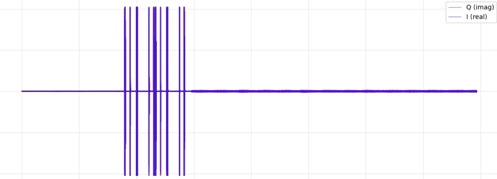
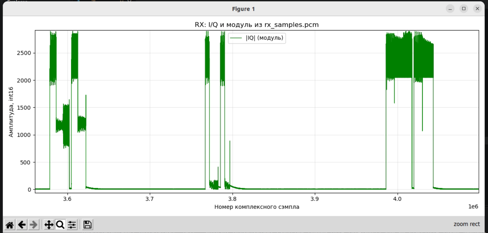
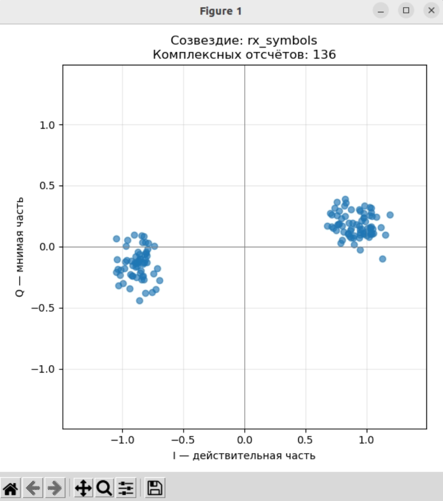

# Отчёт по лабораторной работе

**Тема:** Передача сообщения с модуляцией BPSK между двумя ADALM-Pluto SDR

**Выполнил:** Добромилов Артём

## Цель работы

Сформировать комплексный сигнал из битов текстового сообщения, передать его между двумя SDR и восстановить сообщение из принятой записи. Построить осциллограмму I/Q, график модуля и созвездие принятых символов.

## Оборудование и программное обеспечение

- Два ADALM-Pluto SDR в режимах TX и RX.
- C++17, CMake, SoapySDR и драйвер SoapyPlutoSDR с поддержкой аппаратных временных меток.
- Python 3, NumPy и Matplotlib для обработки записи и отрисовки графиков.

## Параметры сигнала

| Параметр | Значение |
| --- | --- |
| Сообщение | `Work - DOBROMILOV` |
| Размер сообщения | 17 байт, 136 бит |
| Модуляция | BPSK, один бит на комплексный символ |
| Центральная частота линии по конфигу | 800 МГц |
| Частота дискретизации | 2 МГц   |
| Отсчётов на символ | 4 |
| Символьная скорость внутри пакета | 500 ксимв/с |
| Преамбула | 64 символа, 256 отсчётов |
| Формат записи RX | CS16, пары `int16_t` в порядке `I, Q` |

## Формирование и передача сигнала

1. Функция `bits_generation()` преобразует текст в биты. Каждый байт разбирается от старшего бита к младшему.
2. Функция `bpsk_modulate()` ставит в соответствие биту `0` символ `+1 + j0`, а биту `1` — `−1 + j0`.
3. Функция `upsample()` размещает символы через четыре отсчёта. Остальные позиции заполняются комплексными нулями.
4. Функция `convolve()` вычисляет свёртку с прямоугольным фильтром `[1, 1, 1, 1]`. Например, первые два символа `+1` и `−1` проходят следующие этапы.

   ```text
   После вставки нулей: +1  0  0  0  −1  0  0  0
   После свёртки:      +1 +1 +1 +1  −1 −1 −1 −1  0 0 0
   ```

   Каждый символ занимает четыре отсчёта. Последние три нуля образуются при полной свёртке массива с четырёхточечным фильтром.

Перед сообщением добавляется известная приёмнику преамбула. Пакет состоит из 256 отсчётов преамбулы, 544 отсчётов данных и 3 нулей в конце. Всего 803 комплексных отсчёта, что при 2 Мвыб/с занимает около 0,40 мс. Перед отправкой отсчёты масштабируются и записываются в буфер CS16, который дополняется нулями до размера буфера драйвера. Пакет передаётся повторно через `writeStream` с аппаратной временной меткой.

## Приём и декодирование

Приёмник записывает поток I/Q в `rx_samples.pcm`. Скрипт `decode_bpsk.py` оценивает частотное смещение и ищет начало пакета корреляцией с эталоном `tx_preamble.csv`. После уточнения частотной поправки он усредняет каждые четыре отсчёта в пределах символа. Это соответствует выборке выхода прямоугольного согласованного фильтра в моменты символов.

Фаза и масштаб уточняются по преамбуле. Скрипт определяет бит по знаку действительной компоненты. При `I >= 0` получается `0`, при `I < 0` — `1`. Каждые восемь битов собираются в байт. Скрипт сравнивает результат с `tx_symbols.csv` и сохраняет комплексные символы до принятия решения в `rx_symbols.csv`.

На машине, где запись и эталоны находятся в `src/build`, из корня репозитория выполняются команды:

```sh
python3 py_script/oscillogram.py src/build/rx_samples.pcm
python3 py_script/decode_bpsk.py src/build/rx_samples.pcm &&
python3 py_script/constellation.py src/build/rx_symbols.csv
```

## Результаты эксперимента



*Рисунок 1 — осциллограмма принятых I и Q. Всплески выделяются на фоне участков с малой амплитудой. На этом масштабе линии двух компонент накладываются друг на друга.*



*Рисунок 2 — модуль принятого сигнала `|I + jQ|`. Видны участки повышенной амплитуды и паузы между ними. Граница отдельного пакета определяется корреляцией с преамбулой.*



*Рисунок 3 — созвездие 136 символов из успешно декодированной записи. Два облака находятся по разные стороны от `I = 0`. Наклон линии между облаками указывает на остаточный фазовый поворот.*

В контрольном пакете восстановлено сообщение `Work - DOBROMILOV` с **0 ошибками из 136 бит**.

## Вывод

Между двумя ADALM-Pluto SDR передано и восстановлено текстовое сообщение с BPSK. Прямоугольные импульсы получены вставкой нулей и свёрткой, а преамбула позволила выделить пакет из потока I/Q. На созвездии различимы два состояния BPSK. В контрольном пакете приняты все 136 бит без ошибок.
